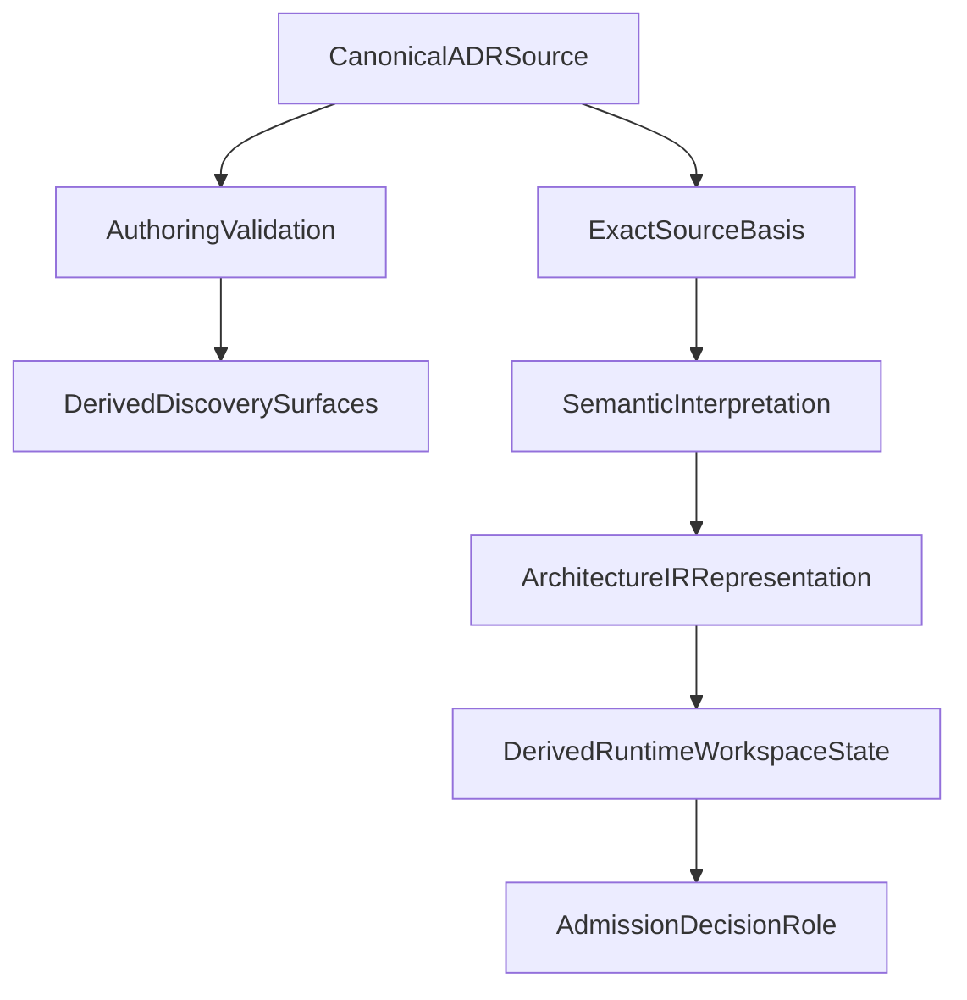
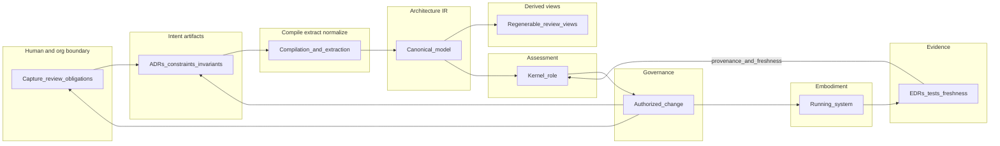

# System Overview

## The Problem

You can know the words and still lack a picture. **Intent**, **Architecture IR**, **Kernel**, **projections**, and **evidence** each sound plausible alone. Without a composed story, readers guess edges: what feeds what, what is canonical, where humans decide, where automation assists, and where **governance** intervenes.

## The Reframe

STE behaves as one system with multiple layers. This chapter names the layers and how they connect. For what STE *is* as a discipline, use [What is STE?](02-01-what-is-ste.md); for word senses, use [Terminology](02-02-terminology.md).

## The Model

Read what follows as one system diagram in prose: subsystems as nodes, artifacts on edges, and flows as paths you could draw on a whiteboard. **Evidence** is observation of **embodiment**: tests, telemetry, analysis outputs, and similar channels, captured as **EDR**-shaped records before assessment consumes it. Observation is not a verdict.

### Authoring surfaces

Canonical ADR source is the authority. The ADR-Kit authoring API produces it. It is not hand-authored. Two branches leave that source. They are not a sequence in which validation manufactures the object interpretation reads.

**Authoring validation** evaluates the canonical record. From that validated path, tooling generates **derived discovery** surfaces: manifest, index, registries where applicable, and rendered projections. Those surfaces support inventory, navigation, inspection, and repository discovery. A fresh or valid discovery surface does not establish interpreted semantic meaning. **Discovery ≠ interpretation.**

**Exact source basis** binding also originates from the canonical authoring source. It identifies the authoritative artifacts semantic interpretation is allowed to consume. It is not an index, registry, manifest, rendered projection, or validation result. If a successful validation check is required before interpretation, that check is a gate or precondition. It is not the producer of the basis.

Semantic interpretation, when available, may realize an **Architecture IR** representation. **ste-spec** owns that semantic model. A repository index is not Architecture IR. Representation is not declaring authority.

Derived runtime or workspace state, and the **admission** decision role, come later. They are **reserved / logical architectural roles** on this path. The authoring kit does not produce admission decisions. Semantic construction of a **detached candidate** is **accepted / designed but not yet released**: it does not persist, promote, or admit, and this chapter does not teach it as something to call.

**What each surface may conclude**

- **Canonical ADR.** What the organization decided. It may conclude a commitment and its rationale. It may not conclude that embodiment matches, or that a check passed.
- **Authoring validation.** Whether the canonical record satisfies authoring contracts. **Implemented / available now.** It may not conclude admission, conformance, or the contents of an exact source basis.
- **Derived discovery.** What is in the repository inventory. **Implemented / available now.** It may not conclude interpreted meaning, applicability, or authority.
- **Exact source basis.** Which authoritative source interpretation is bound to. It may not be reconstructed from discovery, and it is not a validation result.
- **Architecture IR representation.** Machine-facing semantic representation under **ste-spec**, where mapping exists. It may not replace the ADR as declaring authority, and it is not the repository index.
- **Runtime observation and admission.** What was observed, and what a decision role may later allow. Reserved roles here. Observation is not a verdict. Admission is not validation.

**How to read this diagram:** both branches start at the canonical ADR. There is no edge from validation to the exact source basis, and no edge from discovery to interpretation. Later nodes are reserved roles, not a claim that the authoring kit performs them.

### Closed-loop chain (control view)

At handbook altitude, STE is a **closed-loop control** system, not a linear document pipeline. One pass through the loop looks like this:

1. **Human intent** at the boundary (conversation, review, and governed use of the authoring API). People remain accountable for the decision. The canonical ADR is produced by the ADR-Kit authoring API, not by hand.
2. **Intent artifacts:** **ADRs**, requirements, **constraints**, **invariants**, and related normative records.
3. **Authoring validation** of that canonical source, which regenerates **derived discovery**. This step does not construct an exact source basis and does not admit architecture.
4. **Exact source basis** and, where interpretation applies, **Architecture IR** as semantic representation. Discovery is not the input to that representation.
5. **Projections** and other derived views for review. They track commitments. They do not become a second authority.
6. **Implementation / embodiment:** what is built and run.
7. **Evidence:** tests, telemetry, audits, and other observations with provenance. Observation is not a verdict. Handbook evidence models are ahead of treating a named schema as the current supported producer on the authoring path.
8. **Assessment:** **conformance** claims for declared **scopes** under **rules**. The **Kernel** role is the reserved decision role for admission. The authoring kit does not produce those decisions. There is no current supported/public admission producer in this path.
9. **Governance:** authorized change that revises **intent**, **embodiment** plans, or both—and returns the loop to step 1 or 2.

**Governance** is the feedback that makes the loop **closed**: assessment outcomes and policy decisions change what may be built or what is declared true next, instead of “shipping the doc.”

### Major conceptual components

These are roles, not a repo checklist:

1. **Intent plane.** Humans and agents author and revise structured **intent** **artifacts** (including **ADRs** and **invariants**). Conversation interfaces and editing workflows live here at the human boundary. Agents are one **tool class**; they are not the source of accountable **intent** or **governance** judgments.
2. **Authoring and representation.** The ADR-Kit authoring API produces canonical ADRs. Validation evaluates that source and regenerates derived discovery. Semantic interpretation, when in view, reads an exact source basis bound from the same canonical source and may realize **Architecture IR**. The public authoring surface does not compile indexes into meaning, and it does not emit admission.
3. **Projections.** **Projections** render **Architecture IR** and related material into diagrams, documents, and other human-facing views. Multiple projections should track the same underlying commitments when the system is healthy.
4. **Embodiment sources.** Repositories, builds, infrastructure definitions, and runtime systems realize **embodiment**. This is not a passive archive. It is what actually runs.
5. **Evidence collection.** Tests, telemetry, analysis outputs, and similar observations become **evidence** records (**EDR**s in handbook language) with provenance suitable for assessment.
6. **Assessment and admission.** The **Kernel** role is the reserved decision role: when a supported producer provides it, it evaluates evidence and contracts and emits a verdict. Authoring validation is not that verdict. The reference path that once marked admission as a live integration should not be treated as the current seam.
7. **Governance loop.** People and policy close the loop: approve or reject changes, update **intent**, grant bounded exceptions with owners, and schedule re-evaluation.

### Primary artifacts (what moves between boxes)

- **Intent artifacts:** decisions, invariants, constraints, capability maps, and related structured records.
- **Architecture IR:** canonical compiled architecture model.
- **Projections:** derived views for communication and review.
- **Evidence artifacts:** **EDR**-shaped records tying observations to **scopes** and systems under test.

### Flows you should be able to trace

**Flow A: author and validate.** A human closes a canonical ADR → authoring validation evaluates that source → derived discovery regenerates for inspection. An exact source basis, when interpretation is in view, is bound from the canonical source, not from the validation result and not from the index. **Architecture IR**, where mapped, is representation. It is not the index.

**Flow B: assess.** Build or change **embodiment** → produce **evidence** → a decision role may assess **conformance** claims under **rules** → outcomes feed **governance**. Evidence does not decide. The authoring kit does not admit.

**Flow C: govern change.** **Governance** revises **intent** or **embodiment** plans → loop returns to Flow A and Flow B.

### API example (structure only)

Take a backward-compatibility **decision** in **intent** **artifacts**. Compilation ties it to **Architecture IR** elements that interfaces and dependents use. **Embodiment** is running services, gateways, and schemas. **Evidence** enters through CI, telemetry paths, and records that reference **scopes**. **Kernel**-shaped assessment sits where **Architecture IR**, **evidence**, and **rules** meet. **Governance** is the box that receives assessment output and authorizes edits to **intent** or **embodiment** plans. Which choices you make after a mismatch is lifecycle and policy; the structural claim is only that those boxes and edges exist.

### Human, agent, and governance interaction points

- **Where humans are primary:** accountable **decisions**, **governance** judgments, approval or rejection of exceptions, and acceptance when the work is judgment-shaped.
- **Where agents and automation help:** calling the authoring API under governance, regenerating derived discovery, running authoring checks, and gathering **evidence** when **rules** make that safe. The API authors the canonical record. Agents do not become declaring authority, do not construct an exact source basis by validating, and do not admit. Nothing in that path is hand-authored.
- **Where governance must be visible:** any change to normative **intent**, any waiver that alters **constraints** or **invariants**, and any response to sustained non-**conformance** or **drift** that needs an owner.

The boundary is not “human good, machine bad.” The boundary is which steps require explicit **governance** and recorded accountability.

### Diagram companion

A companion Mermaid sketch lives at [`diagrams/system-overview.mmd`](../diagrams/system-overview.mmd). It may evolve independently; this chapter’s prose is the orientation authority if they diverge during drafting. For how to read handbook diagrams versus canonical truth, see [How to read diagrams and projections](02-05-how-to-read-diagrams-and-projections.md).

**How to read this diagram:** it is a **control-loop** sketch, not the authoring surface map above. **Governance** closes the loop back to human capture and **intent** artifacts. Derived views are regenerable and are not a second authority. Repository discovery is not an input that this loop compiles into semantic meaning.

## The Implications

If you can sketch the loop, later chapters become “zoom into this region.” If you cannot, every new term feels like another attachment. The whiteboard test matters: boxes, labeled edges, and a path that returns to **governance** and revised **intent**.

## Relationship to STE system

Deeper treatment appears in the part overviews for intent, Architecture IR, kernel, control loop, projections, conversation, and lifecycle. Useful next anchors:

- [Artifact layer overview](../03-artifacts/03-00-artifact-layer-overview.md)
- [Architecture model (Architecture IR) overview](../04-architecture-model/04-00-architecture-ir-overview.md)
- [Kernel overview](../07-kernel/07-00-overview.md)
- [The governance model](../06-governance/06-02-the-governance-model.md)
- [Projections overview](../04-architecture-model/04-08-projections-overview.md)
- [Conversation engine overview](../09-human-interface/09-00-conversation-engine-overview.md)
- [Section overview (Part 6)](../06-governance/06-00-section-overview.md)
- [Canonical example — AI Gateway through STE](../11-examples/00-overview.md) for intent → derived IR → embodiment → EDR → correction in one thread

Normative interfaces and behavior belong to **ste-spec** and the implementing repositories named in the handbook README, not to this sketch.

**Next:** If diagrams and derived handbook figures still feel ambiguous, read [How to read diagrams and projections](02-05-how-to-read-diagrams-and-projections.md). Then read [The STE lifecycle](02-04-the-ste-lifecycle.md); it uses this same structure as a repeating loop over time: **intent**, **architecture**, **embodiment**, **evidence**, assessment, **conformance**, **change**, and return.

## Summary

- Canonical ADR source splits into authoring validation, which feeds derived discovery, and exact-source-basis binding, which feeds interpretation. **Discovery ≠ interpretation.** Validation is not admission and is not source-basis construction.
- **Intent** artifacts, **Architecture IR** as representation, **projections**, **embodiment**, **evidence**, the reserved **Kernel** decision role, and **governance** are the major structural roles; edges are as in Flows A through C.
- The **closed-loop chain** states the same story as a control loop: **governance** feeds revised **intent** and **embodiment** plans, not a one-way document handoff.
- Three flows cover compile, assess, and govern; real work cycles among them.
- Humans own **governance** and judgment; automation and model-based assistants expand where **intent**, **Architecture IR**, and **rules** are explicit. **Architecture IR** is the conceptual center; AI is not.
- Later parts deepen each region; **ste-spec** defines exact contracts.
