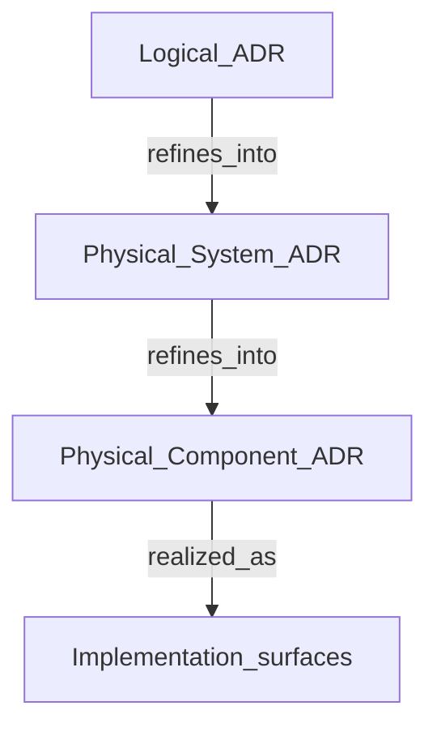

# Architecture Decision Records

**Artifact type:** Architecture decision record (**ADR**).  
**Role in STE:** Capture a chosen commitment and its rationale as a stable **intent** record in the artifact graph.  
**Primary concern:** intent.  
**Connects to:** requirements and **constraints**, **invariants**, **Architecture IR**, **traceability**, **conformance**.

## The Problem this artifact solves

Important choices disappear into memory, tickets, or informal decks. Nobody can reconstruct **why** the system looks the way it does, so redesigns repeat arguments and teams ship incompatible interpretations. **ADRs** exist so decisions are **durable**, **addressable**, and **supersedable** without pretending the past never happened.

## What the artifact is

An **ADR** is a structured record of an architecture **decision**: context, options considered, the chosen commitment, and consequences. In STE it is an **intent** artifact type—an **authoritative closure** of **design space** for the commitment it records, not meeting minutes dressed as architecture. It is not an omnibus narrative that describes the whole system, and it is not source code. **Architecture** is not “ADRs alone”; **ADRs** supply rationale and status—and may declare ADR-local **Normative Propositions**—while **compilation** and related materialization represent those commitments in machine-facing architecture semantics and, where mapped, **Architecture IR**. Representation does not replace the ADR as declaring authority. It may reference **Architecture IR** elements once represented, but the record carries rationale, decision status, and ADR-scoped normative meaning that the IR does not absorb.

STE may distinguish multiple ADR surfaces (for example lifecycle or packaging) in **ste-spec**. At handbook altitude, treat them as one family: recorded decisions with explicit lifecycle.

At a finer grain, current authoring chains **logical** ADRs, **physical-system** ADRs, and **physical-component** ADRs. That ladder is **implemented / available now**. A generic physical ADR (`ADR-P`) is not the preferred current type. Lower layers **refine** upper layers. They do not invent a parallel authority tree.

**What each layer is for**

- A **logical** ADR answers what must be true and why. It must not invent subsystem topology or component interfaces in order to look complete.
- A **physical-system** ADR answers which subsystem boundaries and topology realize that intent. It refines the logical record. It must not replace the logical commitment with a second decision.
- A **physical-component** ADR answers which implementable components, responsibilities, and interfaces carry that topology. It refines the physical-system record. It must not become its own authority tree.

Observation of embodiment is a later role. It is not the next step of authoring, and it is not something the authoring kit performs by compiling the component record.

**How to read this diagram:** each lower ADR **refines** the layer above. Implementation is embodiment of those commitments. Evidence is a separate, later role.

## How it is used in STE

A canonical ADR is produced through the ADR-Kit authoring API. It is not a hand-authored file. **Authoring validation** evaluates that record. **Derived discovery** surfaces are regenerated from that validated path for inventory and inspection. Regeneration does not turn the index into the semantic source. Refinement downward does not create a second authority. **Governance** approves superseding records when the organization changes course.

Validation does not admit the architecture, and it does not produce an **exact source basis**. When interpretation is in view, that basis is bound from the canonical ADR. **Discovery ≠ interpretation.** A fresh index does not establish interpreted meaning. Reviewers use ADRs to ask whether **embodiment** matches recorded commitments. That question is conformance, which is later than authoring validation.

**Example:** An ADR states public API v1 remains backward compatible for twelve months. A breaking change proposal triggers **governance**: supersede the ADR or reject the change, not a debate about memory.

## How it relates to intent, implementation, or evidence

- **Intent:** ADRs are primary **intent**. They state what the organization chose.
- **Implementation:** **Embodiment** should reflect committed decisions; gaps motivate **drift** investigation or record updates.
- **Evidence:** ADRs do not replace tests or monitors, but they explain what **conformance** claims should mean when linked to scopes and checks.

## How it participates in lifecycle and governance

Creating, superseding, or retiring an ADR should follow an explicit path: owner, reviewers, and visibility into impact on **Architecture IR** and **validation** scope. Exceptions (for example a time-bounded waiver) belong in governed records, not only in chat.

## Relationship to other artifacts

- [Requirements and constraints](03-02-requirements-and-constraints.md): ADRs often commit to requirements or tighten **constraints**; requirements can force a new ADR when they change.
- [Invariants](03-03-invariants.md): a decision may introduce or relax **invariants**; both should stay aligned.
- [Architecture model and IR](03-04-architecture-model-and-ir.md): compilation ties decisions to canonical elements where STE defines that mapping.
- [Traceability](03-06-traceability.md): links from ADR identifiers to IR nodes and checks.
- Part 4: [Architecture model (Architecture IR) overview](../04-architecture-model/04-00-architecture-ir-overview.md) for IR depth.
- Part 9: [Decision capture](../09-human-interface/09-03-decision-capture.md) for conversational capture that must still land in durable records.
